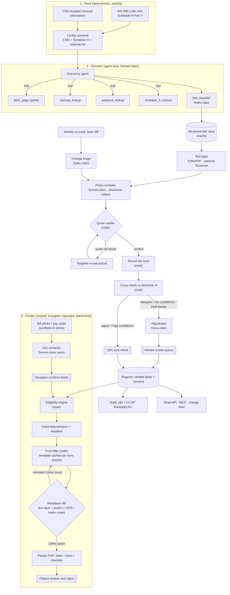

# Charity Care Commons (Texas edition)

*The free-care rules of every Texas nonprofit hospital: open, cited, checked against the hospital's own IRS filing, and compiled into a ready-to-sign application.*

Every nonprofit hospital must offer free or discounted care under IRS §501(r), but each one hides its rules in its own PDF, with its own poverty-level tiers, asset tests, document lists and forms. Patients and the navigators who help them re-research the same public documents case by case, and most eligible people never apply.

Charity Care Commons compiles each hospital's financial-assistance policy (FAP) into executable, versioned data. Every field carries a verbatim quote, a page number and the source document's sha256. Each record is cross-checked automatically against what the hospital reported to the IRS on Schedule H. Disagreements go to a human reviewer first. An unexplained one is listed publicly only after a reviewer has verified the value and the hospital has had a 10-business-day right of reply (or its response is published). On top of the registry, a navigator-operated **packet compiler** does four things:

1. Takes a household's facts (or a bill and pay stubs).
2. Gives a deterministic, cited "likely eligible under §X" estimate.
3. Fills that hospital's own application form and proves the fill with a render-and-readback diff.
4. Adds a cover letter that asks the hospital to suspend extraordinary collection actions under 26 CFR 1.501(r)-6, along with the 240-day deadline.

The data is CC BY 4.0, the code is Apache-2.0, and patients never pay.

> **Form:** open-data infrastructure (registry, read API, MCP server, change feed) plus one navigator-facing workflow tool (the packet compiler).

## What is real and what is synthetic

The working parts and the stand-ins are listed separately below.

| Part | Status |
|---|---|
| **Demo corpus** | **Synthetic.** 8 fictional hospitals (10 facilities) with FAP, application and summary PDFs, Schedule H XML, a CMS CSV, an offline website and hand-made gold labels. No real hospital is named or scored. |
| **CMS facility universe** | **Real data, fetched live** from data.cms.gov (Hospital General Information, dataset `xubh-q36u`). It returned 467 Texas hospitals, 153 of them in scope (voluntary non-profit, not psychiatric), cached in `data/seed/cms_tx_hospitals.csv`. |
| **IRS Schedule H** | **Implemented and tested on local fixtures.** The Part V parser uses pinned xpaths from the IRSx catalogue, and a streaming index-CSV and ZIP batch reader is included. No real IRS batch has been downloaded or reconciled yet. |
| **Discovery** | **Implemented.** It includes a polite fetcher (robots.txt, 5 s per host, domain allowlist, block detection), sitemaps, Wayback CDX, an agent loop and a records-request queue. It has been exercised only against the offline demo web and local test servers; no real hospital site has been crawled. |
| **LLM steps** | **Replay offline, live with a key.** Discovery agent, classifier, compiler, re-ask, adjudicator, change triage, bill and pay-stub extraction, form labelling and the naive baseline all use the Anthropic SDK with structured outputs when `ANTHROPIC_API_KEY` is set. Otherwise they replay fixtures keyed by `(prompt_version, doc_sha256, model_tier)`. Most demo fixtures are **synthetic** (written to match the corpus), not recorded model output. Three are deliberately wrong to exercise the quote gate (`fixtures/llm/DELIBERATE_ERRORS.json`). |
| **Engine, packet, site, API, export** | **Real code, fully offline.** The deterministic engine agrees with an independent oracle on 300 synthetic households. Packets are filled with PyMuPDF and read back. |
| **OCR** | **Optional.** Tesseract is used if installed; otherwise the PyMuPDF text layer is used. Without OCR, image-only pages abstain (`illegible`), which costs the demo some threshold abstention. |
| **Naive-agent baseline** | **Simulated** in replay mode (labelled SIMULATED in eval reports and on the site's eval page, with replayed costs marked the same way); `CCC_LLM=record` replaces it with real runs. |

## Quick start (offline, no API key, zero cost)

```bash
make install        # pip install -e ".[dev]"
make demo           # ccc demo: the whole pipeline, about 15 s
make test           # pytest -q
make serve          # API, review console and navigator at http://127.0.0.1:8000
```

`ccc demo` runs every stage on the synthetic corpus and prints one line per stage:

```
[ 1] corpus    hospitals=8, files=75, checksum=70a269d61e21ab3f, matches_committed=True
[ 2] seed      facilities=10, schedule_h_coverage=1.0, needs_review=0
[ 3] discover  policies_found=8/8, ... agent_tool_calls=46
[ 4] compile   fields={'provisional': 176, 'abstained': 8}, crosschecks={'agree': 68, 'disagree_unexplained': 1}, reasked=[...]
[ 5] review    approved={'crosscheck_disagreement': 1, 'field_verify': 136}, left_open={'quote_unverified': 3, 'round_trip_mismatch': 1}, ...
[ 6] screen    facility=tx-459901, outcome=likely_free, arithmetic=$49,700 ÷ $27,320 (2026 FPG, HH of 3) = 181.9% FPL ≤ 200% (free care tier)
[ 7] packet    bill_amount=9,400.00, statement_date=2026-10-10, readback=13/13 fields match, verified=True, pages=4
[ 8] evals     full=ok, engine=ok, packet=ok, targets_missed=['full:threshold_abstention_rate', 'full:calibration_ece']
[ 9] export    rows={'fields': 184, 'crosschecks': 69, 'facilities': 10, 'policies': 8}
[10] site      pages=15, data_files=15
```

What each stage does:

1. **Corpus:** regenerates the corpus and checks it byte for byte against the committed manifest.
2. **Seed:** loads the CMS universe and Schedule H Part V into a SQLite registry.
3. **Discover:** crawls the offline hospital websites, then stores, hashes and classifies the PDFs.
4. **Compile:** uses the replay backend and runs the quote gate, one targeted re-ask, round-trip tests against printed income tables, the Schedule H cross-check and the Opus-class adjudicator.
5. **Review:** an explicit **demo reviewer** (`demo:gold-reviewer`, which never runs without a demo flag) approves tasks whose values match gold. It leaves the three deliberate fixture errors and the stale printed income table in the human queue.
6. **Screen:** the engine screens persona Maria's household (household of 3, $49,700, $9,400 ER bill, first statement 2026-10-10).
7. **Packet:** builds the PDF from extraction, fill and readback.
8. **Evals:** scores the registry this run built.
9. **Export:** writes the CC BY CSV and Parquet files.
10. **Site:** builds the static site.

Outputs:

| Output | Path |
|---|---|
| Static site | `site/dist/index.html` |
| Registry | `data/demo-run/registry.sqlite` |
| Packet | `data/demo-run/packet/packet.pdf` (plus `deadline.ics`) |
| Data release | `data/demo-run/release/*.parquet\|csv` |
| Eval report | `data/demo-run/evals/report/latest.md` |

All of these are gitignored and regenerated.

`ccc demo --no-evals` skips the eval suites. `ccc demo --json` prints the full stage report. `ccc demo build` only regenerates the corpus.

### Going live

```bash
export ANTHROPIC_API_KEY=...          # or CCC_LLM=live; CCC_LLM=record records new fixtures
ccc seed run --live-cms --zip 2026_TEOS_XML_01A.zip --db data/registry.sqlite
ccc discover run --db data/registry.sqlite
ccc compile --db data/registry.sqlite all
ccc review --db data/registry.sqlite queue
```

Spend is capped per run (`CCC_RUN_TOKEN_CEILING`) and per day (`CCC_DAILY_SPEND_CAP_USD`).

## The `ccc` command

| Command | What it does |
|---|---|
| `ccc demo` | whole pipeline offline (see above); `ccc demo build` regenerates the corpus |
| `ccc seed cms\|demo\|run\|schedule-h` | S1: CMS universe, Schedule H Part V, facility reconciliation |
| `ccc discover demo\|run\|link-health\|records` | S2-S3: discovery agent, document store, link health, records-request letter |
| `ccc compile facility\|all\|demo\|queue` | S4-S9: compile, quote gate, round trip, cross-check, adjudication, review tasks |
| `ccc review queue\|decide\|demo-auto` | S8: the review queue; `decide` applies approve, edit, abstain or ask_hospital (same code path as the console) |
| `ccc screen <facility> --size --income ...` | deterministic, cited screening |
| `ccc households build\|score` | the 300 synthetic households and engine-vs-oracle agreement |
| `ccc packet fixtures\|template\|demo` | packet compiler |
| `ccc export` | CC BY 4.0 snapshot (CSV + Parquet + dataset card + manifest) |
| `ccc site build` | static site |
| `ccc serve` | FastAPI read API, review console (`/console`) and navigator page (`/navigator`) |
| `ccc mcp` | MCP server over stdio (`find_facility`, `get_policy`, `screen_household`, `list_changes`) |
| `ccc eval run\|gate\|report\|...` | eval harness (same as `python -m evals`) |
| `ccc schema export`, `ccc db`, `ccc fpg`, `ccc llm` | Open FAP Schema, registry, poverty guidelines, backend config |

## Architecture



Module map, data flow, registry IDs and fixture conventions are in [docs/ARCHITECTURE.md](docs/ARCHITECTURE.md). Each stage lives in `src/charitycare/<stage>/` with tests in `tests/<stage>/`:

| Stage | Package |
|---|---|
| Seed | `seed/` |
| Discover | `discover/` |
| Compile | `compile/` |
| Engine | `engine/` |
| Packet | `packet/` |
| API and console | `api/` |
| Static site | `site/` |
| Export | `export/` |
| Synthetic corpus and the `ccc demo` orchestrator | `demo/` |

The eval harness is the top-level `evals/` package. Shared contracts are in `schemas.py` (Pydantic v2, exported as the Open FAP Schema in `schemas/open-fap-schema.json`), `store.py` (SQLite registry; Postgres is the production target), `llm.py` (live, replay and record backends with cost accounting and spend caps), `fpg.py` and `wording.py`.

## Read API

Every GET returns `{data, meta}`. `meta` carries `as_of`, `last_verified`, `stale`, `disclaimer_version`, the licence and the schema version.

| Method | Path | Purpose |
|---|---|---|
| GET | `/v1/facilities?state=&coverage=&q=` | facilities with coverage, free-care cutoff and IRS check |
| GET | `/v1/facilities/{id}` | one facility, its Schedule H sections and hospital responses |
| GET | `/v1/facilities/{id}/policy?as_of=` | the governing policy version (facility→policy resolution) |
| GET | `/v1/policies/{version_id}/fields?status=` | compiled fields with quotes, pages, sha256 and status |
| GET | `/v1/policies/{version_id}/crosschecks` | Schedule H cross-checks |
| GET | `/v1/discrepancies` | unexplained Schedule H disagreements ("discrepancy for review") that are reviewer-verified, on the current policy version, and past the hospital's reply window or answered |
| GET | `/v1/changes?since=` · `/v1/changes.atom` | change feed (JSON and Atom) |
| GET | `/v1/link-health` | source URL health |
| POST | `/v1/screen` | deterministic screening; `Cache-Control: no-store`; nothing about the household is stored or logged |
| POST | `/v1/corrections` | a hospital's correction or response; opens a review task |
| GET/POST | `/console`, `/console/tasks/{id}` | maintainer review console (token-protected) |
| GET/POST | `/navigator`, `/navigator/extract`, `/navigator/confirm`, `/navigator/screen`, `/packet` | bill and pay-stub reading with a confirmation step, navigator screen and packet PDF (`X-CCC-Packet-Verified` header) |

Rate limits are 60 requests per minute per IP and 600 with an API key. Example:

```bash
curl -s -X POST localhost:8000/v1/screen -H 'content-type: application/json' \
  -d '{"facility_id":"tx-459901","household":{"household_size":3,"annual_income":"49700","insured":false,"county":"Bexar","first_statement_date":"2026-10-10"}}'
```

## Evaluation

Targets are from design section 12. Values come from the offline replay run on the synthetic demo corpus (`make eval`; report in `evals/reports/latest.md`). The demo splits are small (3-5 hospitals), so the bootstrap 95% confidence intervals are wide.

| Metric | Target | Demo (replay) |
|---|---|---|
| Numeric thresholds, exact match | ≥ 97% | 100% |
| Threshold abstention rate | ≤ 10% | **13-17% (miss: no OCR for an image-only page)** |
| Categorical macro-F1 | ≥ 0.90 | 1.00 |
| List item F1 | ≥ 0.85 | 0.97 |
| **Citation validity** (hard gate) | **100%** | 100% |
| Schedule H free-%FPG agreement / disagreements triaged | ≥ 85% / 100% | 100% / 100% |
| Engine vs oracle, 300 households (hard gate) | 100% | 100% |
| Readback exact match (fillable and flat) | 100% / ≥ 98% | 100% / 100% |
| Packets labelled verified with any mismatch | 0 | 0 |
| Calibration ECE | ≤ 0.05 | **0.065 (miss: fixtures report a flat 0.93 confidence)** |
| Cost per hospital / per packet | ≤ $0.50 / ≤ $0.10 | about $0.13 / $0.03 (simulated at list prices) |
| Naive-agent baseline gap | ≥ 20 points | +40 points (**simulated**, illustrative only) |

CI runs ruff and pytest, then `ccc demo` end to end, then the offline suites against `evals/baselines/`, then the Open FAP Schema compatibility check. A gate fails on a drop of more than 2 points, citation validity under 100%, or a cost rise above 25%. A live `smoke` suite runs on PRs that touch prompts, schemas or the compiler, and only when the API key secret exists. See `.github/workflows/`.

## Trust, privacy and wording

- **The LLM never decides eligibility.** It extracts and cites; code computes; people verify. Code never sets `verified`; only a reviewer decision does. The demo reviewer is labelled `demo:` everywhere it acts.
- **No quote, no publish.** Every published field's quote is re-found on the cited page of the hashed document. Failures get one re-ask, then the field abstains with reason `quote_unverified`.
- **Wording guard.** User-facing text says "likely eligible" and "discrepancy for review", never the banned terms. Site builds and API renders fail on a hit.
- **No PII persistence.** Households live in request memory only. Packets are built in a temp directory deleted in `finally`. Packet metrics hold no household data. SSNs, dates of birth, account numbers and signatures are never filled.

## Roadmap status (design section 14, 8-week plan)

Week 0 is outreach and not code, so it is not started. Weeks 1-8 are below; **[x]** means implemented and tested in this repo, and **[ ]** means not done.

**Week 1: facility universe and discovery (R1)**
- [x] CMS universe (live pull) plus Schedule H Part V parser with pinned xpaths and narrative URL recovery
- [x] Facility reconciliation with stable IDs and a coverage report
- [x] Discovery agent with fetcher, sitemap and Wayback
- [x] Versioned sha256 document store
- [ ] Playwright rendering for JavaScript-heavy sites (httpx only today)
- [ ] Real Texas coverage measured against live hospital sites

**Week 2: schema, gold set, compile v0 (R2)**
- [x] Open FAP Schema v0.1
- [x] Compiler with quote verifier and round-trip tests
- [x] Synthetic gold labels for 8 demo hospitals
- [ ] Real gold set (40 dev + 15 double-coded)
- [ ] Labelling UI

**Week 3: cross-check, review, evals (R2, R3)**
- [x] Schedule H cross-check and Opus-class adjudicator
- [x] Review queue with provisional and verified states
- [x] Eval harness v1, CI gates and naive-agent baseline harness
- [ ] Batch compile of all real Texas policies

**Week 4: engine, site, API (R6)**
- [x] Deterministic engine and 300 synthetic households
- [x] Static site (dashboard, hospital pages, methods, evals, data)
- [x] CC BY CSV and Parquet export
- [x] Read API and `/v1/screen`
- [ ] Attorney review of the disclaimers and cover letter

**Week 5: packet compiler, fillable forms (R5)**
- [x] Fillable-form fill with bake and readback
- [x] Cover letter, checklist, 240-day calculator and `.ics` file
- [x] Bill and pay-stub extraction with a confirmation overlay (navigator step 0: low-confidence and missing fields must be ticked or edited before they pre-fill the form; `ccc packet demo` needs `--accept-extracted`)
- [ ] Confirmation UI beyond the navigator form

**Week 6: flat forms (R5, R4)**
- [x] Flat and scanned form templates (drawings, raster blanks, vision labelling, human-verify task)
- [x] Readback with text layer and pixels, plus optional Tesseract and Haiku-class crops
- [ ] Top-25 real hospital templates
- [ ] Design-partner sessions

**Week 7: changes, MCP, outreach (R4)**
- [x] Change detection and triage, Atom and JSON feed (a new FAP version found by discovery is diffed against the one it supersedes; discovery uses the deterministic triage, which treats any changed number, negation or modal word as substantive)
- [x] Link-health page
- [x] MCP server
- [x] Hugging Face dataset card
- [ ] Zenodo DOI release
- [ ] Pre-publication hospital emails (drafts only, in `docs/OUTREACH.md`)
- [ ] Second-state coverage script

**Week 8: second state and launch**
- [ ] Second state
- [ ] Public launch

Known limitations:
- The right-of-reply window is recorded (`hospital_notice`, started when a reviewer confirms a discrepancy) but sending the notice to the hospital is a manual maintainer step; business days skip weekends only, not holidays.
- The map uses approximate county centroids.
- Spanish packets fill the Spanish form, but the letters are English only.
- The rate limiter and console auth are single-process.

## Licensing

Code: Apache-2.0 ([LICENSE](LICENSE)). Data releases: CC BY 4.0 ([DATA_LICENSE](DATA_LICENSE)). The demo corpus is entirely fictional: any resemblance to a real hospital is accidental.

## Disclaimer

Charity Care Commons provides legal information, not legal advice. "Likely eligible" is an estimate based on the hospital's published policy as of the date shown, quoted with the result, and the facts you entered. The hospital makes the final decision. We are not affiliated with any hospital or the IRS. Confirm details with the hospital. For free full-service help, contact [Dollar For](https://dollarfor.org). See [docs/DISCLAIMER.md](docs/DISCLAIMER.md), [docs/PRIVACY.md](docs/PRIVACY.md) and [docs/METHODS.md](docs/METHODS.md).
